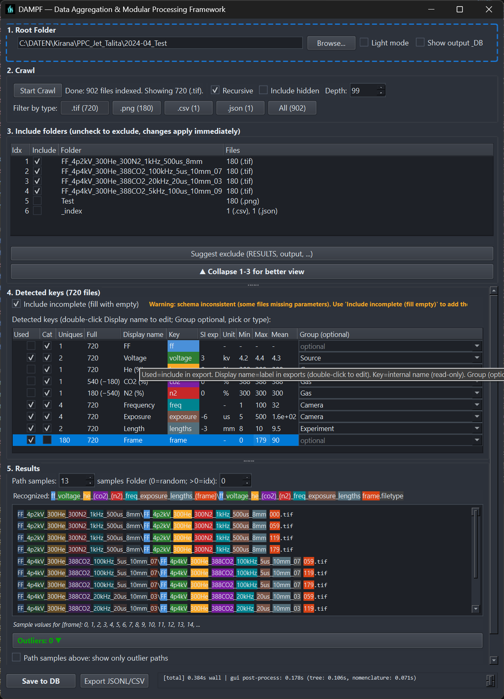

# DAMPF — Data Aggregation & Modular Processing Framework

**DAMPF is the data ingestion and indexing component of the WETTER framework.**

It scans experimental data folders, extracts semantic information from file and folder names, and converts unstructured measurement archives into a structured, queryable dataset.

Instead of manually organizing large experiment folders, DAMPF automatically interprets naming conventions and builds a machine-readable index that can be used by other tools in the WETTER ecosystem.

*Filename semantic indexer*: structures measurement data by folder and file names.

## WETTER Framework

This project is part of the **WETTER framework**, a modular architecture for structured processing and exploration of experimental imaging datasets.

Typical workflow:

**Raw Data → DAMPF → KEIM → WOLKE → BLITZ**

Each component handles a specific stage in the data pipeline:

- **DAMPF** — semantic indexing of measurement datasets based on file and folder names  
- **KEIM** — statistical extraction and dataset analysis  
- **WOLKE** — web-based exploration of indexed datasets  
- **BLITZ** — high-performance interactive image exploration

A broader overview of the ecosystem and links to all modules can be found at:

**https://wetter.mess.engineering**

Architecture background and early design concepts were presented at the DPG Symposium:

📄 https://wetter.mess.engineering/docs/BLITZ_WOLKE_DPG25V2_Compact.pdf

---

## Purpose

DAMPF automatically structures large collections of measurement files based on folder and file naming conventions.

Semantic information such as date, run number, temperature, exposure time, camera ID, sample name, or modality is extracted from paths and filenames and mapped into a uniform machine-readable schema.

The resulting dataset can then be explored and analyzed by other tools in the WETTER ecosystem.

Typical use cases:
- Scientific image data (PNG, TIFF, JPG)
- NumPy arrays (NPY, NPZ)
- CSV/text measurement data
- HDF5 files
- Mixed folder structures with experimental parameters in the path

---

## Indexing Pipeline

Pipeline:

1. **Folder scan**
   - Recursive
   - Filter on defined file types

2. **Tokenization**
   - Split on `_ - . /`
   - Split at letter↔digit boundaries
   - Include folder names

3. **Rule-based parsing**
   - Date detection (ISO, compact)
   - Run / Rep / Trial
   - Camera / Channel / ROI / Frame
   - Exposure (ns, us, ms, s)
   - Temperature (°C, K)
   - Frequency, voltage, current
   - Modality tags
   - Processing tags (raw, dark, flat, avg, ...)

4. **Structured schema**
   Each file is stored as a dict, e.g.:

   {
     "date": "2026-02-28",
     "run": 3,
     "temp": {"val": 20.0, "unit": "c"},
     "exposure": {"val": 2.0, "unit": "us"},
     "camera": 1,
     "modality": "ir",
     "processing": ["raw"],
     "path": "...",
     "confidence": 0.93
   }

5. **Structured output**
   Each file becomes one row in index.jsonl/index.csv and optionally in the SQLite data table.

This pipeline transforms loosely organized experiment folders into a structured dataset that can be queried, filtered, and analyzed programmatically.

---

## Configuration

**CLI:** In script [filename_semantic_indexer.py](filename_semantic_indexer.py) adjust at the top: `ROOT_DIR`, `OUTPUT_DIR`, `ALLOWED_SUFFIXES`, `FOLDER_TOKEN_DEPTH`.

**GUI:** Set root and output folders; save schema as project.json/project.ini and reload ("Load root according to schema").

**Naming conventions:** [Naming_Cheat_Sheet.md](Naming_Cheat_Sheet.md) (quick reference) | [Proper_file_naming.md](Proper_file_naming.md) (DE) | [Proper_file_naming_EN.md](Proper_file_naming_EN.md) (EN) – schema, recognized spellings, extension.

---

## GUI and standalone EXE

- **Start:** `python gui.py` or `dist\DAMPF.exe` (after build).
- **Workflow:** Choose root folder → Start crawl → Check/adjust nomenclature → Save schema (project.json/ini) and/or save to database (SQLite).
- **Schema:** Save detected structure as project.json (or project.ini); load any other root "according to schema" and crawl again.
- **Detected keys (4.):** Two columns: "Display name" = label in exports (double-click to edit), "Key" = internal parameter name from parsing (read-only).
- **Outliers / typos:** When paths deviate from the schema or likely typos in folder names, DAMPF shows an outlier list with suggestions (e.g. rare folder name similar to a frequent one). Optional: "Outliers only in path overview" filters the displayed paths.
- **Build EXE:** `pyinstaller DAMPF.spec` → `dist\DAMPF.exe` (single file, no Python installation required).
- Output (SQLite, JSONL/CSV) can be used by **WOLKE** (Dash/Plotly, SQL) and **BLITZ** (Image Viewer).

---

## Output

DAMPF produces a structured index where each measurement file corresponds to one row in a dataset.

- `index.jsonl` → One line per file (numeric values without unit columns)
- `index.csv` → Excel-friendly overview (columns without unit)
- `index_meta.json` → Column metadata (unit, raw_unit per quantitative column)
- **SQLite** (optional): One data table `data` plus `column_metadata` (unit, raw_unit per column); optional `config` for DAMPF schema. DAMPF defines the schema; WOLKE/BLITZ build on it. Quantitative columns hold numeric values only; units in `column_metadata` (traceability).
- Confidence score per file

---

## Why rule-based?

File names are usually semi-formal.  
Rules are:

- deterministic  
- reproducible  
- fast  
- easy to debug  

A tiny LLM or ML model is optionally useful when:

- naming conventions vary strongly  
- many ambiguities occur  
- new conventions should be recognized automatically  

Baseline is intentionally deterministic.

---

## Extension

- Add new regex rules
- Add domain-specific tokens
- Refine confidence logic
- Optional: ML fallback for unknown tokens

---

## Status

Engineering baseline for structured indexing of large measurement archives. GUI and SQLite backend implemented; aggregations (min/max/mean per group) planned as next step.
