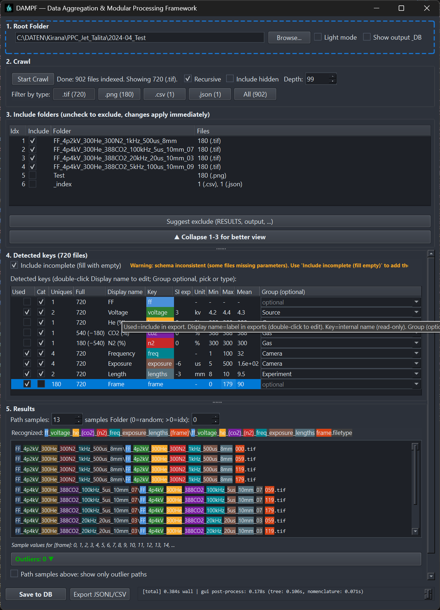

# DAMPF

Indexes folder and file names into a **SQLite** database — one row per file — for querying and for the rest of the [WETTER](https://wetter.mess.engineering) pipeline.

**Download:** [latest release](https://github.com/PiMaV/DAMPF/releases/latest) — `DAMPF-vX.Y.Z.exe` (Windows) / `DAMPF-vX.Y.Z-linux-x86_64` (Linux).

1. Download the binary for your platform.
2. Linux: `chmod +x DAMPF-vX.Y.Z-linux-x86_64`, then run it. Windows: run the `.exe`.
3. Set the crawl **root**, click **Crawl**, adjust which keys to keep, then **Save to DB**.

**Step 4 — Detected keys**

- **Used** — which keys become columns. None checked means all keys; any checked means only those.
- **Type** — Numeric or Category. A folder or underscore block that changes becomes a column (Category). More than 10 distinct numbers become Numeric. Category stores TEXT so WOLKE shows a filter instead of a histogram. A block that is the same in every file stays gray. The dropdown overrides the suggestion.
- **Uniques** — distinct values in the current file set.
- **Full** — how many files have the key; `(−N)` means N files are missing it.

**Naming:** [Cheat sheet](docs/naming/cheat_sheet_v2.md) · [full convention](docs/naming/file_names_explained_v2.md)

For agents: [`docs/llm-brief.md`](docs/llm-brief.md).

---

Developed by [M.E.S.S.](https://mess.engineering).
